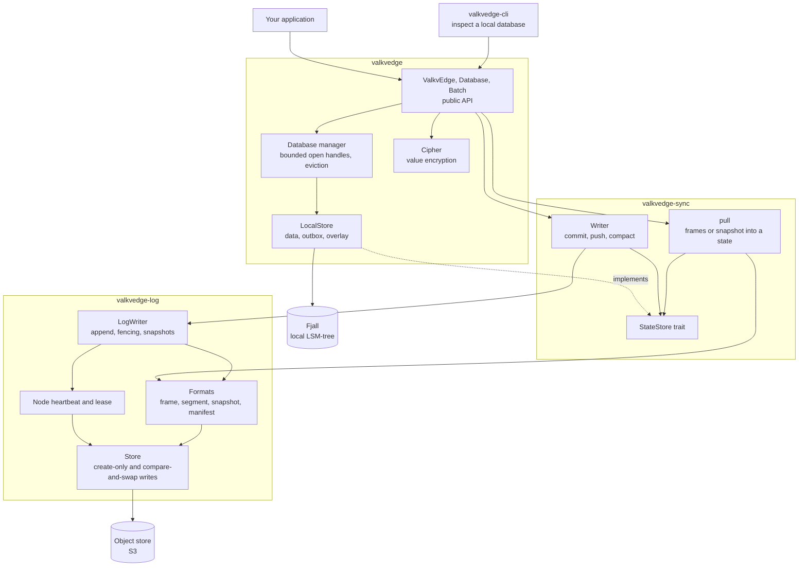
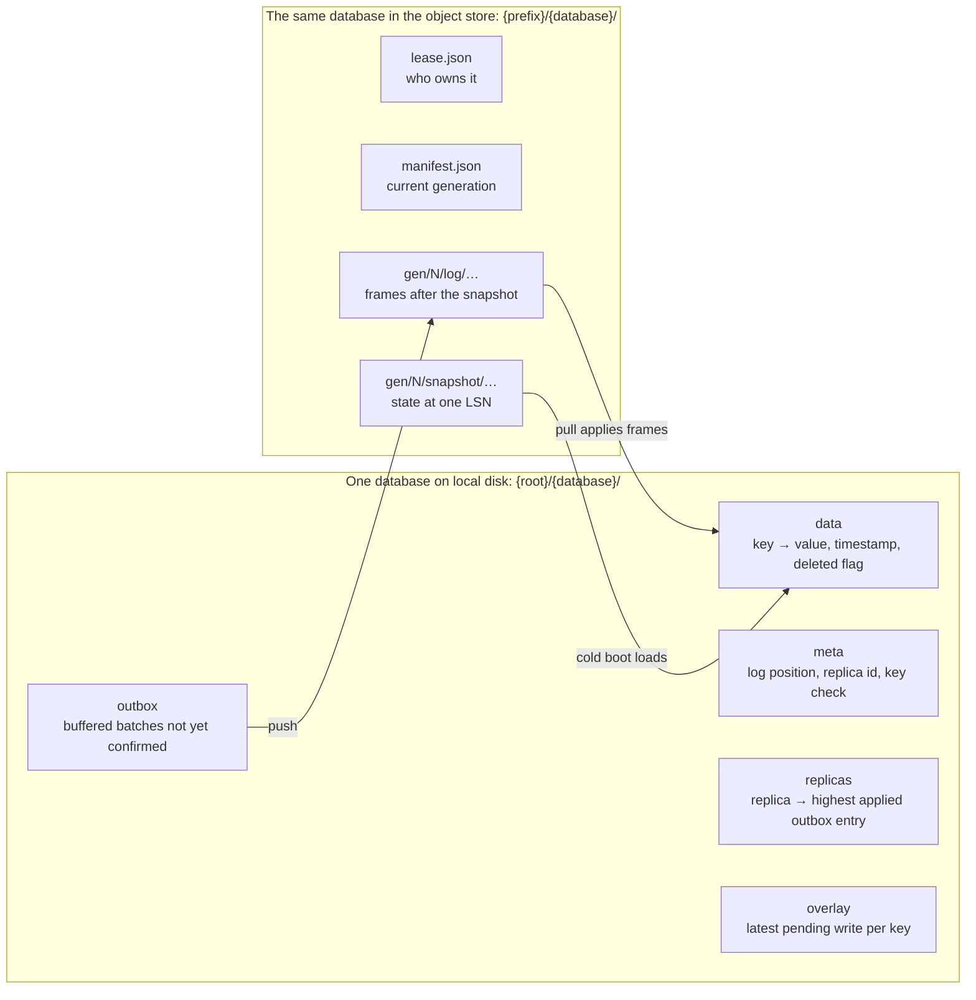
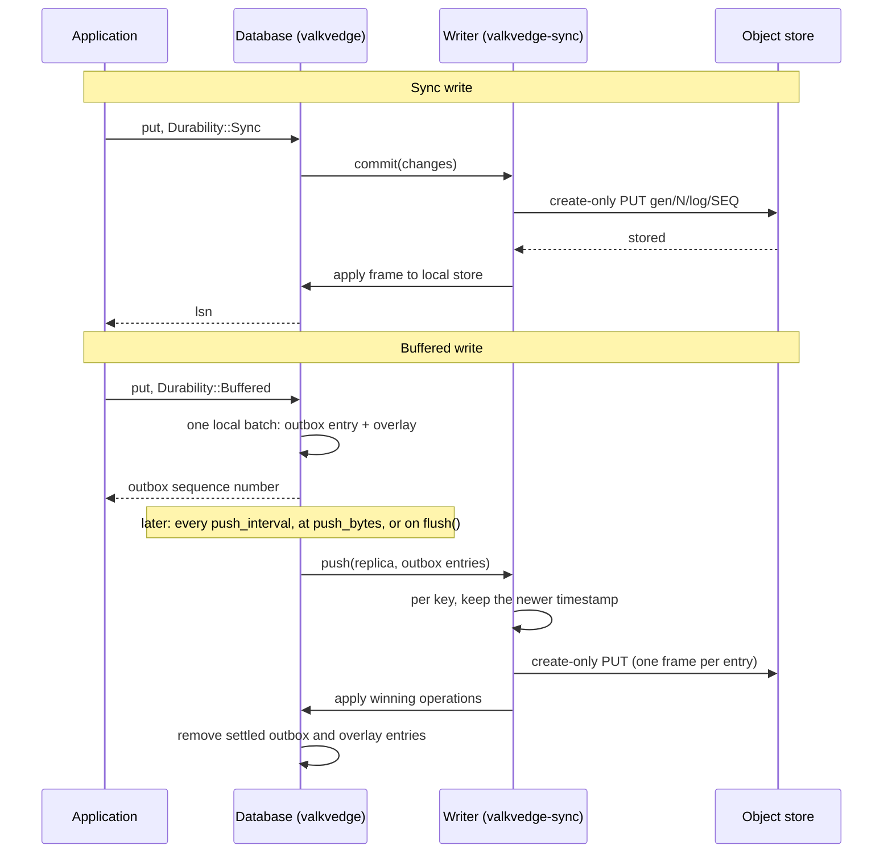
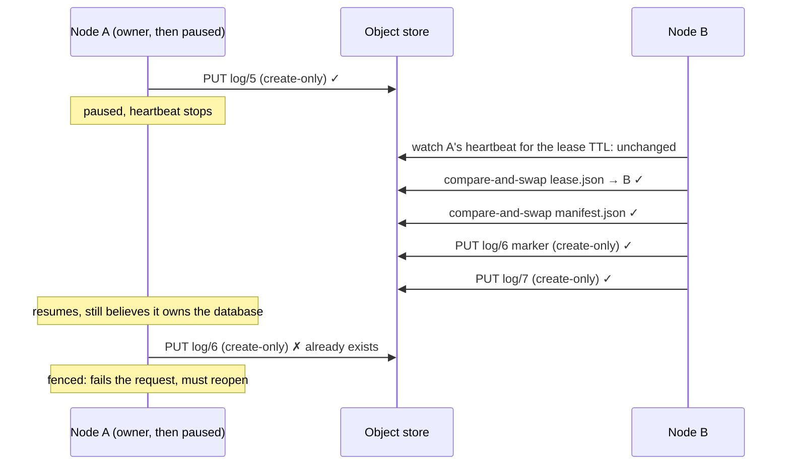

# Library components

How the library is put together: the crates, what each one owns, and how a read, a
write and a failover move through them.

For the bytes that end up in the object store, see [format.md](format.md). To run any
of this yourself, see [testing-locally.md](testing-locally.md).

## The idea in one paragraph

A database is an append-only log of batches, kept in an object store. One process at a
time, the *writer*, may append to it. Every process that uses the database, writer or
not, keeps a full local copy in an embedded LSM-tree and answers reads from that copy.
Replicas bring their copy up to date by reading the log. When the log gets long the
writer writes a snapshot and starts a new *generation*, so a new replica never has to
replay history.

## Crates

Dependencies point one way: `valkvedge` → `valkvedge-sync` → `valkvedge-log`.

| Crate | Owns | Does not know about |
|---|---|---|
| `valkvedge-log` | The object formats and their checksums. Conditional writes. Who owns a database (leases) and how a previous owner is locked out (fencing). | What the frames mean. Any local storage. |
| `valkvedge-sync` | Turning a log into a state (`pull`). Turning writes into a log (`Writer`): ordering, conflict resolution, compaction. | Fjall. It works against the `StateStore` trait. |
| `valkvedge` | The API. The local store on Fjall. Which databases are open. The outbox. Encryption. | Object keys and lease mechanics. |
| `valkvedge-cli` | Reading a local database from the command line. | — |

`StateStore` is the seam between replication and storage. `valkvedge-sync` ships an
in-memory implementation (`MemState`) so its tests need no disk; `valkvedge` implements
it on Fjall.

## What is stored where

Everything on the left except the outbox can be rebuilt from the right. The outbox is
the only local data that exists nowhere else, which is why a rebuild keeps it.

## Reads

A read never leaves the process.

1. `Database::get` asks the manager for the open local store, reopening it if it was
   closed to make room.
2. The overlay is checked first: a pending buffered write to that key wins.
3. Otherwise the replicated value is returned.
4. If the database is encrypted, the value is opened with the caller's key.

Scans (`range`, `prefix`) merge the overlay and the data in key order and skip deleted
keys. An iterator keeps its database open until it is dropped.

## Writes

Two properties to notice:

- **A sync write touches local state only after the object store has it.** A failed
  sync write leaves nothing to undo.
- **Sync writes made together share one object.** While one segment is being written,
  commits that arrive wait, and the next segment carries all of them, one frame (and
  one LSN) each. Conditions are checked in order, against the commits before them in
  the same segment. A commit alone is written at once, so this adds no delay; under
  load it cuts object-store writes. `ValkvEdge::commits_and_segments` reports both
  counts.
- **A buffered write needs no network at all.** It does not even take the lease. The
  lease is taken when the outbox is pushed.

### When the object store is unreachable

Only three things wait on the object store: a sync write, a push of the outbox, and a
replica's pull. Each sync write and each push is bounded by `sync_write_timeout`
(10 seconds by default) and then fails with `UNAVAILABLE`. Reads, scans and buffered
writes are local and are not affected.

A write that timed out or failed leaves the writer unsure of where the log ends: the
store may have accepted the segment without the answer arriving. So the writer session
is thrown away. The next write opens a new one, which takes the lease again, re-reads
the tail of the log, and applies anything it finds there to the local store before
continuing. The application does nothing: the same `Database` handle keeps working once
the store is back. The outbox is untouched by a failed push and is sent again; the
watermark makes the retry safe.

Opening a session can take longer than one write is willing to wait, for example while
watching a dead owner's lease expire. That work is not cancelled when a write gives up.
It continues in the background, and a later write finds the session ready.

### Conflicts

Every operation carries a hybrid logical clock timestamp: wall-clock milliseconds, a
counter, and the replica id. Sync writes are stamped by the writer at commit, later than
anything it has seen. Buffered writes are stamped by the replica when they are made.

When the writer receives pushed operations it compares each one with what it holds for
that key and keeps the newer. The log contains only winners; replicas apply it in order
and never re-decide. The push result says, per operation, whether it was applied,
superseded, or rejected:

- stamped more than `max_clock_skew` in the future: rejected, so a replica with a wrong
  clock cannot win every future conflict;
- older than `tombstone_retention`: rejected, because the writer may no longer remember
  a delete it would need to compare against.

The replica's highest applied outbox entry (its *watermark*) is recorded in the log
itself. A push that is retried, even against a different writer after a failover, is
recognised and not applied twice.

## One writer at a time

Two separate mechanisms, on purpose.

**The lease decides who should write.** `lease.json` names the owning node. It is created
with a create-only write and changed only by compare-and-swap. Each node renews a small
heartbeat object every few seconds. Another node may take a lease only when the owner
released it, restarted, or its heartbeat has stood still for the lease TTL as measured
on the watcher's own clock. Clocks on different machines are never compared.

**Fencing makes a wrong belief harmless.** A node can lose its lease without knowing: it
was paused, or cut off from the store. So ownership is also enforced by the log:

- A segment's key is its sequence number, and segments are written create-only. Two
  writers cannot both occupy a position.
- A new owner immediately writes an empty *marker* segment at the next position and
  rewrites the manifest. The previous owner's next append hits an occupied position; its
  next compaction fails its compare-and-swap.
- A node whose own heartbeat is overdue refuses to write, checked before the upload and
  again before acknowledging.

The heartbeat runs on its own thread with its own runtime, so a busy or blocked
application runtime cannot make a healthy node look dead.

## Replicas and generations

`pull` reads the manifest and then:

- **Same generation:** reads the segments after its position, checks each one chains to
  the previous by checksum and continues at the next LSN, and applies them.
- **One generation behind, old segments still present:** finishes the old generation
  from frames, then moves to the new one.
- **Empty, further behind, or the old segments are gone:** discards replicated state,
  loads the current snapshot, then applies the segments after it.

Applying a segment and recording the new position are one atomic local write, so
replaying after a crash changes nothing. A snapshot load that is interrupted leaves a
mark; the next pull sees it and starts the load again.

Compaction is the writer writing a snapshot of its own state, in bounded parts, then
swapping the manifest to a new generation. Deletes older than the retention window are
left out. The previous generation is kept for a grace period for replicas that are
slightly behind, then deleted.

## History

With a history window (`WriterConfig::history`, or `DatabaseBuilder::history` for one
database), the writer keeps what it needs to rebuild the database as it was at any
point in that window: one **base** snapshot, at or before the window's start, and every
log segment since, across generations. At each compaction the snapshots of replaced
generations are deleted, except the base's and those of restores; their logs stay.
Storage is about one snapshot plus what was written in the window.

The state at a point (an LSN, or a time by each frame's commit time) is the newest kept
snapshot at or before it, with the log applied up to the point
(`valkvedge_sync::state_at`). Once the base is a quarter of the window older than it
needs to be, the writer rebuilds the state at the generation the window now starts in,
uploads it as that generation's snapshot, and deletes what came before; this runs in
the background after a compaction, in a scratch store under the root (`.scratch`). So
the history reaches back at least the window and at most a quarter further.

`Database::restore(point)` rebuilds that state and installs it as a new generation whose
snapshot is one LSN past the tail. No log leads there, so every replica reloads the
snapshot, exactly as when it is too far behind. Writes after the point are undone;
replicas' watermarks are kept at their highest, so pushes already applied are not
applied twice. The restore is itself in the history. `Database::branch_from(source,
point)` does the same into an empty database, without watermarks: a copy that then
goes its own way. Encrypted databases cannot be branched, since values are sealed to
the database's name.

**Following changes.** `valkvedge_sync::changes(store, layout, after, limit)` reads the
frames after an LSN, in order, for a program that follows a database's changes rather
than holding a copy. It reads across generations while their logs are kept: within the
history window, or for the grace after a compaction without one. A frame list stops at a
restore: `Changes::reset` is then the restore's LSN, and the follower reads the whole
state again and goes on from there. When the frames after the LSN are no longer kept,
it fails with `NOT_IN_HISTORY`. Values are as stored: ciphertext for an encrypted
database.

**Partial replicas.** A replica opened with `DatabaseBuilder::prefixes` keeps only the
keys under those prefixes (at most 16). It reads the same segments and snapshot parts,
and the local store drops every operation and snapshot entry outside the prefixes as it
applies them. Frames still advance its LSN, so its position means what it means for any
replica. The prefixes are recorded in the local store. Opened again with others, the
copy is marked for a snapshot load and downloaded again; that is refused while the
outbox holds writes not yet uploaded. Reads, scans, watches and writes that reach
outside the prefixes fail with `NOT_REPLICATED`, since the copy cannot answer them. A
writer holds the whole database and cannot be partial.

## Many databases in one process

Each database is its own Fjall database in its own directory. Databases can be grouped
into namespaces (`kv.namespace("acme").database("orders")`): a namespace is a
subdirectory locally and a sub-prefix in the object store, so a group can be listed or
removed as a unit, and two namespaces can each have a database of the same name.

The manager keeps at most
`max_open_databases` of them open.

- Opening one more when the limit is reached closes the least recently used database
  that nothing is using.
- A database is "in use" while an operation or an iterator holds it. If every open
  database is in use, the open waits up to `open_wait_timeout`, then fails with
  `TOO_MANY_OPEN_DATABASES`.
- A `Database` handle stays valid after its store was closed. The next call reopens it.
- A background task closes databases that have been idle for `idle_close_after`.

Closing a store to make room does not release its lease: the process is still alive and
still the owner. `ValkvEdge::close` releases leases.

## Values that expire

`put_with_ttl` (or `Batch::put_expiring` with a time) stores a value with an expiry. The
expiry travels with the operation: in the outbox, in the log (operation kind 2, see
[format](format.md)), in snapshots and in every local copy.

- **Reads.** Once the time has passed, every copy reads the key as absent by its own
  clock: `get`, scans, `expires_at`. A condition treats it as having no value, so
  `if_absent` and `update` can write it again at once.
- **Deletion.** The writer deletes expired values with ordinary deletes, at most 1,000
  per commit, from the background task every `push_interval`, or when
  `Database::expire` is called. Each delete is conditioned on the key still having no
  live value, so a key written again in the meantime is left alone. Replicas, watchers
  and change feeds see the delete like any other. The deleted value stays in the
  history for the history window, like any delete.
- **Finding them.** A local index orders expiring keys by time. Rows are added as values
  are applied, and dropped lazily once they no longer match their key's value.
- **Writing again** replaces the expiry: a plain `put` keeps the value for good.
- **Encryption.** The expiry is stored beside the value, not sealed with it, like the
  timestamp: the writer must be able to see it without the key.

## Encryption

With a key, each value is sealed with ChaCha20-Poly1305 under a random nonce before it
becomes part of an operation. From then on the outbox, the overlay, the local data, the
log segments and the snapshots all hold ciphertext. The database name and the key (name)
are bound into the seal, so a ciphertext copied to another key or database does not open.

Key names are not encrypted, because ordered scans and conflict resolution need them.

A sealed marker is stored in the manifest and locally. Opening with the wrong key, or
with no key, fails with `INVALID_ENCRYPTION_KEY` before any value is read.

## Errors

One error type, `valkvedge::ValkvEdgeError`, with a stable `code()` for programs and a
message for people. The codes are listed in
[`error.rs`](../crates/valkvedge-log/src/error.rs).

## Without an object store of your own

The same `valkvedge` API can run against a hosted service: `Builder::remote(url,
api_key)`. The local store, the outbox, the overlay and encryption are unchanged. What
is replaced is the bottom of the stack: instead of `valkvedge-sync` and `valkvedge-log`
reading and writing the object store, a small HTTP client
([`remote.rs`](../crates/valkvedge/src/remote.rs)) sends sync writes and outbox entries
to the service and asks it for frames and snapshots. The frames and snapshot parts it
receives are in the same formats, checked the same way. An open database is
followed by a background task that asks the service for what comes next and is
answered as soon as it exists, so changes arrive as they happen rather than at the
next poll. See [hosted-api.md](hosted-api.md).

## Not here yet

- Bulk loading of snapshots through Fjall's ingestion API.
